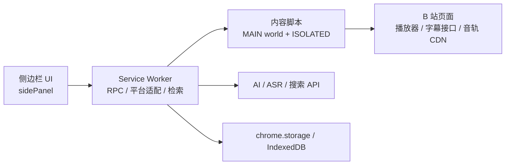

<div align="center">
  
  <p><b>在 B 站视频侧边栏里，抓字幕、做转录、生成 AI 总结，然后导出。</b></p>
</div>

<p align="center">
  <a href="https://github.com/Universe366/bilibili-subtitle-assistant/releases"></a>
  <a href="LICENSE"></a>
  
  
</p>

<p align="center">
  <a href="#快速开始">快速开始</a> ·
  <a href="#功能">功能</a> ·
  <a href="#架构">架构</a> ·
  <a href="#开发与测试">开发与测试</a> ·
  <a href="#文档">文档</a> ·
  <a href="https://github.com/Universe366/bilibili-subtitle-assistant/releases">下载</a>
</p>

> Chrome / Edge MV3 扩展 · 所有配置在侧边栏内完成 · 无 Obsidian 集成 · API Key 只保存在本机
>
> **非官方项目**，与哔哩哔哩无关联。自己的代码使用 MIT；内置 FFmpeg core 按 GPL 分发，见 [`THIRD-PARTY-NOTICES.md`](bilibili-subtitle-assistant/THIRD-PARTY-NOTICES.md)。

---

## 为什么用它

B 站视频的字幕、音轨、评论和简介散在不同接口里，想整理成一份可用的笔记通常要来回切换工具。这个扩展把它们收进一个侧边栏：

- 有官方字幕就直接抓，没有就语音转录；
- 转写完可以 AI 校对、总结、分段、生成章节；
- 想导出 SRT、Markdown 或学习笔记，一键完成；
- 需要外部信息时，联网结果只作为**补充提醒**，不会把总结变成一份来源列表。

## 功能

| 能力 | 说明 |
|---|---|
| **字幕抓取** | 网络嗅探 / 播放器实例 / wbi 签名接口 / 无签名接口 / 主动触发，五路汇总；带时长与归属校验，避免串分 P、串视频。 |
| **语音转录** | 没有官方字幕时：解析音轨 → 分块下载 → 解码 → 16 kHz 单声道 → 重叠切片 → 逐片识别 → 去重合并；支持 FFmpeg 流复制重封装、并发与随时终止。 |
| **AI 总结** | 流式 Markdown、思维链独立折叠、长视频分段总结再合并；生成前可先联网校对字幕。 |
| **AI 对话** | 基于当前视频字幕提问，流式输出，支持 MCP 工具与 Skills。 |
| **联网补充** | 默认 DeepSeek 官方搜索（复用 AI Key）；也支持 Tavily / 博查 / Serper / 智谱 / 秘塔 / 百度千帆 / Brave / Exa / Jina / SearXNG；无 Key 时自动落到免费引擎。 |
| **校对与替换** | AI 修正错别字 / 同音字 / 术语 / 数字 / 时间；规则组、术语表、一键应用与回退。 |
| **导出** | SRT / WebVTT / ASS / TXT / Markdown / JSON，6 种格式 × 4 种模板。 |
| **批量与历史** | 批量队列、章节、质量自检、历史记录、操作留痕。 |

## 快速开始

1. 从 **[Releases](https://github.com/Universe366/bilibili-subtitle-assistant/releases)** 下载最新 zip，解压。
2. 打开 `chrome://extensions`（Edge 为 `edge://extensions`）→ 开启「开发者模式」→「加载已解压的扩展程序」。
3. 选择解压后的 **`bilibili-subtitle-assistant/`** 目录（包含 `manifest.json` 的那一层，不是仓库根目录）。
4. 打开任意 B 站视频页，点击工具栏图标，侧边栏会在右侧打开。

首次使用可以只抓官方字幕，不需要任何 Key。要用 AI 总结 / 转录 / 联网时，再去 **设置** 里填对应平台的 Key。

> 当前通过 GitHub Releases 分发，Edge 商店上架暂缓。更新后请在扩展页点刷新，并**刷新所有已打开的 B 站页面**。

## 架构



- **主环境桥**负责读取页面里的播放器状态、字幕接口和音轨字节（Referer 必须由页面发出）。
- **Service Worker** 负责 RPC、平台调用、重试与错误翻译；service worker 与面板是两份独立代码。
- **侧边栏**只做 UI 与业务编排，所有配置都在这里完成。

## 适合谁

- 想把 B 站课程、访谈、技术分享整理成笔记 / 字幕文件的人；
- 需要批量处理多个视频、或视频没有官方字幕的人；
- 愿意自己填 AI / ASR Key，换更可控的总结与转录。

**不适合**：想要完全零配置、或需要“自动上传 / 自动发布”的场景。

## 开发与测试

```bash
cd verify
npm install
npm test              # 21 个 node 套件
npm run test:browser  # 4 个真实浏览器套件（需要 Chrome/Edge）
```

当前 **21 个 node 套件、1437 项断言**全部通过；浏览器套件需要本地 Chrome，未在 CI 中运行。

## 文档

| 文件 | 内容 |
|---|---|
| [`bilibili-subtitle-assistant/README.md`](bilibili-subtitle-assistant/README.md) | 用户文档：安装、配置、功能、故障排查 |
| [`CONTRIBUTING.md`](CONTRIBUTING.md) | 怎么跑测试、怎么提 PR |
| [`LICENSE`](LICENSE) | MIT（本项目代码） |
| [`bilibili-subtitle-assistant/THIRD-PARTY-NOTICES.md`](bilibili-subtitle-assistant/THIRD-PARTY-NOTICES.md) | FFmpeg.wasm 等第三方组件许可证 |
| [`bilibili-subtitle-assistant/CHANGELOG.md`](bilibili-subtitle-assistant/CHANGELOG.md) | 按版本汇总的新增 / 修复 / 清理 |
| [`bilibili-subtitle-assistant/AGENTS.md`](bilibili-subtitle-assistant/AGENTS.md) | 给 AI / 贡献者：环境硬约束、踩坑、排查方法论 |
| [`bilibili-subtitle-assistant/docs/history/DEVELOPMENT-LOG.md`](bilibili-subtitle-assistant/docs/history/DEVELOPMENT-LOG.md) | 逐轮缺陷与修复复盘（开发记录，不是使用文档） |
| [`PRIVACY.md`](PRIVACY.md) | 隐私政策 |
| [`bilibili-subtitle-assistant/docs/EDGE-STORE.md`](bilibili-subtitle-assistant/docs/EDGE-STORE.md) | Edge 商店文案、权限理由与认证备注（暂缓使用） |
| [`verify/README.md`](verify/README.md) | 测试套件说明与运行方式 |

## 说明

- API Key 只保存在 `chrome.storage.local`，不同步到其他设备，也不会上传。
- MCP 只支持远程 `http` / `sse`；浏览器扩展无法启动本地进程，因此不支持 `stdio`。
- 非 M4A 平台的语音转录会把音频解码进侧边栏内存，长视频转录时请保持侧边栏打开。
- DeepSeek 官方搜索按**成功请求**计费（$0.75 / 1000 次），可在设置中换回免费引擎。

## License

本项目代码使用 [MIT](LICENSE)。内置 FFmpeg core 为 GPL-2.0-or-later 构建，详见 [`THIRD-PARTY-NOTICES.md`](bilibili-subtitle-assistant/THIRD-PARTY-NOTICES.md)。

---

<p align="center">
  <sub>如果这个项目对你有帮助，欢迎 Star 或提 Issue。</sub>
</p>
